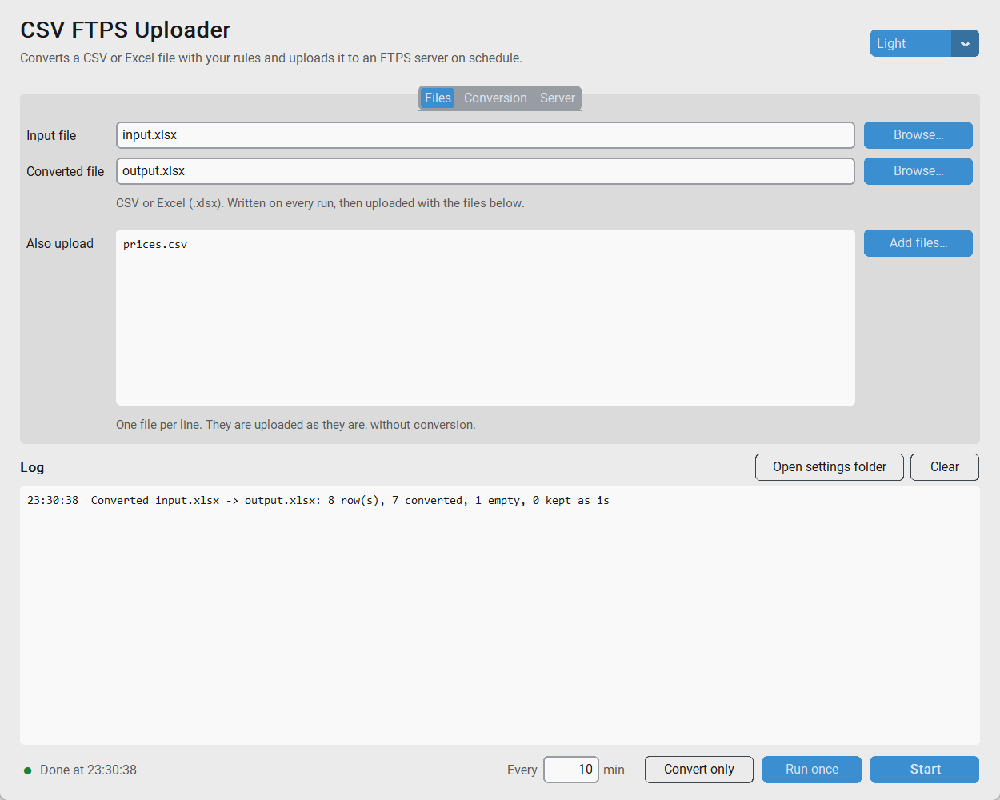

<div align="center">


# CSV FTPS Uploader

**Convert a CSV or Excel file with your own rules and upload it to an FTPS server on a schedule.**

[](https://github.com/SilentCasting/csvftps/actions/workflows/ci.yml)
[](https://github.com/SilentCasting/csvftps/releases/latest)
[](https://www.python.org/)
[](LICENSE)

English · [Українська](README.uk.md)

<picture>
  <source media="(prefers-color-scheme: dark)" srcset="docs/screenshot-dark.png">
  
</picture>

</div>

## Why

A price list or stock export often has to reach a partner's FTP server every
few minutes, and the partner wants some values in their own format: not
`7.5`, but `6-10 inch`. CSV FTPS Uploader does that loop for you:

1. reads your CSV or Excel file and turns the numbers in one column into named ranges;
2. saves the result as CSV or Excel and uploads it, plus any other files, to an FTPS server;
3. waits and does it again, every 10 minutes or whatever you choose.

## Features

- 🔁 **Runs on a schedule** and keeps going when the network or server is down
- 🧮 **Your own ranges**: `from ≤ value < to` → any label; empty and `NULL` cells too
- 🏷️ Column by **number or name**; multi-section files with repeated header rows
- 📊 **CSV and Excel** (`.xlsx`, `.xlsm`) in, CSV or `.xlsx` out, any sheet
- 🔒 **Encrypted uploads**: TLS for the login *and* the data, certificate checked
- 🔑 **Password in the system keyring** (Windows Credential Manager), not in a file
- ♻️ **Retries** dropped connections and only re-sends what did not make it
- 🛡️ **Never uploads half a file**: the converted CSV is written to a temp file first
- 🌗 Desktop app with light and dark theme, and a **command line tool**
- 💾 **Portable `.exe`** for Windows; no Python needed

## Download

Grab **`CsvFtps.exe`** from the
[latest release](https://github.com/SilentCasting/csvftps/releases/latest)
and run it. Nothing to install.

> Windows SmartScreen may warn about an unknown publisher because the exe is
> not code-signed. Click **More info → Run anyway**, or build it yourself
> from source (see below).

## Install from source

Requires Python 3.10+.

```bash
git clone https://github.com/SilentCasting/csvftps.git
cd csvftps
pip install .
```

This installs two commands: `csvftps-gui` (the app) and `csvftps` (the CLI).

## Usage

### Desktop app

```bash
csvftps-gui
```

1. **Files**: choose the input file (CSV or Excel) and where to save the
   converted one; `.csv` or `.xlsx` picks the format. Add any other files
   that should be uploaded as they are.
2. **Conversion**: pick the column (and the Excel sheet, if not the first)
   and edit the ranges. The defaults are the size groups `None`, `2-5 inch`,
   `6-10 inch` and `> 10 inch`.
3. **Server**: enter the host, user and password, then **Test connection**.
4. Press **Start**. The app converts and uploads right away, then every
   *N* minutes. **Run once** does a single run; **Convert only** skips the upload.

Settings are saved automatically. To start the schedule as soon as the app
opens, for example from the Windows Startup folder, run it with `--start`:

```bash
CsvFtps.exe --start
```

### Command line

```bash
csvftps init              # create a settings file with the defaults
csvftps set-password      # save the FTPS password in the system keyring
csvftps test              # check the login
csvftps run               # convert and upload now, then every `interval` seconds
csvftps run --once        # a single run, e.g. from Task Scheduler or cron
csvftps convert           # only convert, no upload
csvftps convert -i stock.xlsx -o stock.csv   # Excel in, CSV out
```

```text
2026-10-12 09:30:00 INFO    Converted input.csv -> output.csv: 8 row(s), 7 converted, 1 empty, 0 kept as is
2026-10-12 09:30:01 INFO    Uploaded prices.csv (21 B)
2026-10-12 09:30:01 INFO    Uploaded output.csv (348 B)
2026-10-12 09:30:01 INFO    Uploaded 2 file(s) to ftp.example.com
2026-10-12 09:30:01 INFO    Next run at 09:40:00
```

| Option | Description |
| --- | --- |
| `-c, --config FILE` | Settings file to use (default: see below) |
| `-q, --quiet` | Only print warnings and errors |
| `--log-file FILE` | Also append the log to `FILE` |
| `run --once` | Run once and exit |
| `run --no-upload` | Only convert |
| `run --interval SECONDS` | Override the time between runs |
| `convert -i CSV -o CSV` | Override the input and output files |
| `set-password --delete` | Forget the saved password |

Exit codes: `0` success, `1` the run failed (or some files were missing),
`2` bad settings or arguments.

## Settings

The app and the CLI share one TOML file:

- Windows: `%APPDATA%\csvftps\config.toml`
- Linux/macOS: `~/.config/csvftps/config.toml`

Use `-c` (CLI), pass a path to the app, or set `CSVFTPS_CONFIG` to use
another file. Relative paths inside it are resolved against its folder.
A commented example is in [`examples/csvftps.toml`](examples/csvftps.toml);
try it without a server:

```bash
csvftps convert -c examples/csvftps.toml
```

```toml
interval = 600                    # seconds between runs

[files]
input = "input.csv"
output = "output.csv"
extra = ["prices.csv"]            # uploaded as they are

[csv]
delimiter = ";"                   # CSV files only
header_column = 3                 # rows with a marker in this column are headers
header_markers = ["Name Exchange"]

[excel]
sheet = "Stock"                   # Excel input only: a name or a number from 1; first sheet if left out

[convert]
column = "Size"                   # or a 0-based index such as 4
empty_values = ["", "NULL"]
empty_label = "None"

[[convert.ranges]]                # min <= value < max, first match wins
min = 2
max = 6
label = "2-5 inch"

[server]
host = "ftp.example.com"
port = 21
user = "dealer"
remote_dir = "/upload"
verify_certificate = true         # false only for a self-signed server you trust
```

### How values are converted

- The first row, and every row with one of `header_markers` in
  `header_column`, is a header and is copied unchanged. When `column` is a
  name, it is looked up again in every header.
- Cells listed in `empty_values` become `empty_label`.
- Numbers (`7.5` and `7,5` both work) get the label of the first range
  they fall in.
- Anything else (text, short rows) is kept as it is and reported in the log.

### Excel files

The format of each file follows its extension: `.xlsx` and `.xlsm` are read
as Excel, `.xlsx` is written as Excel, anything else is CSV. So any mix
works: Excel to CSV, CSV to Excel, or Excel to Excel.

- Cells are read as the text a CSV export would show: `12`, `7.5`,
  `2026-10-25`, `TRUE`. Formulas give the value Excel last calculated.
- In the Excel output, plain numbers are stored as numbers, header rows are
  bold and the first row is frozen. Text such as `007` stays text, and text
  starting with `=` is never turned into a formula.
- Old `.xls` workbooks are not supported: save them as `.xlsx` first.
  Macro workbooks (`.xlsm`) can be read but not written.
- `delimiter` and the encodings only apply to CSV files.

### The password

The password is never written to the settings file. It comes from the
`CSVFTPS_PASSWORD` environment variable if set, otherwise from the system
keyring (Windows Credential Manager, macOS Keychain, Secret Service on Linux).
Save it with `csvftps set-password` or the **Remember password** box in the app.

## Development

```bash
python -m venv .venv
.venv\Scripts\activate          # Linux/macOS: source .venv/bin/activate
pip install -e ".[dev,build]"

pytest                          # run the tests
ruff check . && ruff format .   # lint and format
python packaging/build_exe.py   # build dist/CsvFtps.exe
```

The tests check the default ranges against the original 2022 script on
thousands of values, convert real workbooks both ways, and drive the
upload code through a fake FTPS server.

### Releasing

Bump `__version__` in `src/csvftps/__init__.py`, update `CHANGELOG.md`,
then push a tag:

```bash
git tag v1.0.0
git push origin v1.0.0
```

GitHub Actions runs the tests, builds the exe and publishes the release.

### Project layout

```text
src/csvftps/
├── config.py       # settings: dataclasses, TOML load/save, validation
├── transform.py    # conversion: headers, ranges, atomic write
├── excel.py        # reading and writing .xlsx workbooks
├── upload.py       # FTPS upload with TLS, retries and resume
├── credentials.py  # password from the environment or the system keyring
├── runner.py       # one run (convert + upload) and the schedule loop
├── cli.py          # command line interface
├── gui.py          # CustomTkinter desktop app
└── assets/         # app icon
examples/           # sample CSV, workbook and commented settings
tests/              # pytest suite
packaging/          # PyInstaller build script
```

## License

[MIT](LICENSE) © SilentCasting
